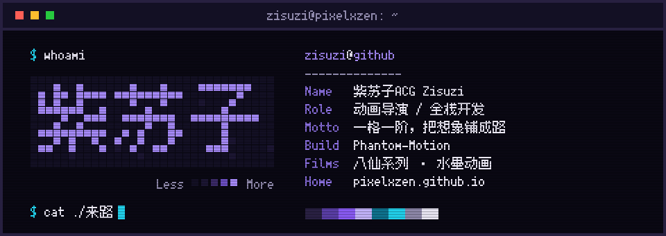

<!--
[INPUT]: pixelxzen.github.io 公开资料（身份、作品、社交）；assets/banner.svg 由 scripts/banner.py 生成。
[OUTPUT]: GitHub 个人主页首屏：横幅、联系入口、在做、在拍、在写。
[POS]: 紫苏子ACG 的门面。置顶仓库与贡献图紧随其下，故本文件不重复列开源项目。
[PROTOCOL]: 变更时更新此头部，改横幅文案改 scripts/banner.py 的 CONTENT 后重跑，别手改 SVG。
-->

  
  

    <a href="https://pixelxzen.github.io">pixelxzen.github.io</a> ·
    <a href="https://x.com/Pixelxzen">X</a> ·
    微信公众号「紫苏子ACG」
  

### 在做

- **[Phantom-Motion](https://github.com/pixelxzen/phantom-motion)** · 动态视觉叙事 —— 给一个念头，还你一帧帧会呼吸的画面。能力只受想象力限制。
- **[设计解构卡 Design Decoder](https://github.com/pixelxzen/design-decoder)** · 浏览器扩展 —— 拆开任意网页的活体设计系统：面积加权配色、字阶、CSS 变量，一键导出 `DESIGN.md`。
- **[微信读书公众号盯采](https://github.com/pixelxzen/Zisuzi-Weread-MP)** · Obsidian 插件 —— 让公众号更新自己走进知识库：扫码登录微信读书，新文章连图片、音视频一起落成 Markdown 笔记，数据只走你自己的账号。
- **紫苏子ACG** · 动画短片 —— 一个人一支队伍：编剧、分镜、生成、配音、剪辑、发布，全流程一个人走完。

### 在拍

- **八仙故事系列** · 粤语水墨动画 —— 丰子恺式的留白、古琴、粤语旁白，把老故事讲给孩子听。
- **紫苏子漫画** · 日漫多格科普 —— A4 竖版，一格一个知识点。

### 在写

- **公众号「紫苏子ACG」** · AI 影像与独立开发的一线笔记 —— 一个导演怎么把 AI 变成一整支剧组：分镜、生成、配音、剪辑，每一环都记录踩过的坑。
